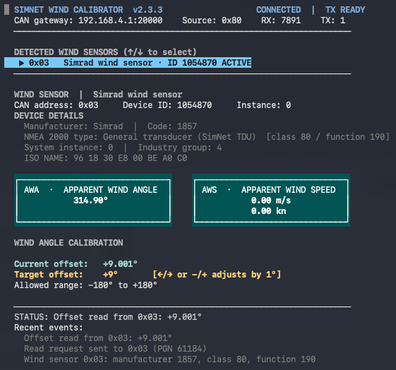

# SimNet Wind Calibrator

A small terminal application for calibrating the **apparent wind angle (AWA)** of Simrad wind sensors on **NMEA 2000 / SimNet** networks. It discovers wind data automatically, shows live AWA and apparent wind speed (AWS), and lets you adjust the angle offset in **1° steps** from **−180° to +180°**.



## Features

- Live **AWA** (degrees) and **AWS** (m/s and knots).
- Automatic discovery of wind sensors and display of their device information.
- Read the current wind-angle offset; adjust the target using arrow keys or direct entry.
- Confirm before writing. Read back the value after applying a change.
- Automatic TCP reconnection, with no automatic replay of pending calibration changes.
- English terminal UI for Windows, macOS, and Linux.

**Compatibility:** Tested with a Simrad IS12 wind sensor and an Actisense WGX-1 gateway in bidirectional **CAN RAW ASCII over TCP** mode. Other wind sensor models and gateways have not been verified. The current version enables calibration only for devices identifying as Simrad; compatibility with B&G wind sensors is unknown.

## Requirements

- Python **3.10+**.
- A bidirectional CAN RAW ASCII TCP gateway connected to the NMEA 2000 / SimNet network.
- `prompt_toolkit` 3.x (automatically installed by the launchers).

## Run

**Windows:** Double-click `run.bat`, or run `run.bat` in a terminal.

**macOS / Linux:** Run `./run.sh`.

The launchers create a local `.venv` on first use and install the Python dependency. At startup, the app asks for your gateway's **IP address / hostname** and **TCP port**, with editable defaults `192.168.4.1` and `20000`.

At startup, the app also asks **Enable logging? [Y/n]**. Press Enter to keep the default **Yes**. When enabled, session logs go into the `logs/` folder next to the application (created automatically). Turning logging off does not affect the on-screen status and recent events.

To install manually:

```sh
python3 -m venv .venv
# On Windows use: .venv\Scripts\python.exe
. .venv/bin/activate
python -m pip install -r requirements.txt
python wind_calibrator.py
```

You can also pass `--host`, `--port`, and `--source` (default CAN source `0x80`). Use `--logging` or `--no-logging` to set the initial logging choice; the startup question remains editable. `--no-prompt` skips all startup questions, so the command-line logging choice applies directly. The default is logging enabled. Use `--log-dir PATH` for a different directory.

Examples:

```sh
./run.sh --no-logging --no-prompt
./run.sh --logging --log-dir my-logs
```

On Windows, use `run.bat` instead of `./run.sh`. Use `python wind_calibrator.py --help` for all options.

**Gateway setup:** Enable bidirectional **CAN RAW ASCII** on a TCP server. Choose an unused NMEA 2000 / SimNet source address for the calibrator. This application does not perform full NMEA 2000 / SimNet address claiming; use it on a controlled network.

## Controls

| Key | Action |
| --- | --- |
| ← / → or − / + | Adjust target offset by 1° |
| G | Enter a whole-number target angle |
| A | Apply (opens confirmation) |
| Y | Confirm write |
| N / Esc | Cancel |
| R | Read current offset |
| ↑ / ↓ | Select wind sensor |
| Q / Ctrl+C | Quit |

Only the **target** changes while adjusting. The current offset is updated after the sensor confirms and a fresh read returns the requested value. If confirmation times out, read the offset again to check the sensor.

## Safety

**Do not calibrate while underway or while an autopilot is steering by wind.** Use a stationary, controlled setup. Make a note of the original offset before changing it. Changes affect the readings published by the wind sensor.

The gateway connection is unencrypted; keep it on a trusted local network. When enabled, local session logs in `logs/` may include gateway addresses or device identifiers; review them before sharing. The `logs/` folder is ignored by Git.

**Provided as-is; use at your own risk.** This software is provided **“AS IS”**, without warranties of any kind. Incorrect calibration or unexpected device behavior may affect wind data and equipment that relies on it. You are responsible for verifying settings and using the tool safely. To the maximum extent permitted by law, the authors and contributors are not liable for loss or damage arising from its use.

## Development

Run the offline tests with `python -m unittest discover -s tests -v`. On macOS/Linux, `python -m tests.smoke_tui` exercises the interface against a simulated gateway. GitHub Actions tests Python on Linux and Windows. These tests do not replace real hardware testing.

## License

[Apache License 2.0](LICENSE). Independent community software; not affiliated with or endorsed by Simrad, Navico, B&G, or Actisense. Product names are used only to describe compatibility.
